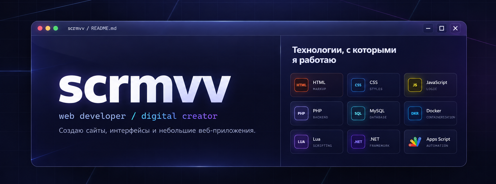

 

### Привет! 👋

Я занимаюсь разработкой сайтов, интерфейсов и небольших веб-приложений.
Нравится не только собирать красивый интерфейс, но и разбираться в логике, данных и автоматизации.

### Мой стек

  

### Активность

Змейка генерируется автоматически через GitHub Actions и появится после первого успешного запуска workflow.
